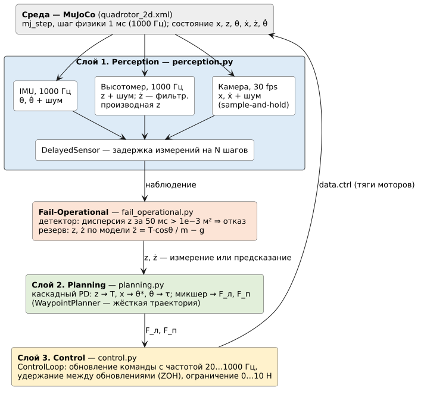
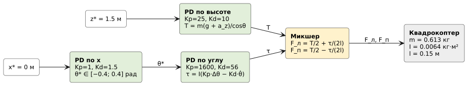
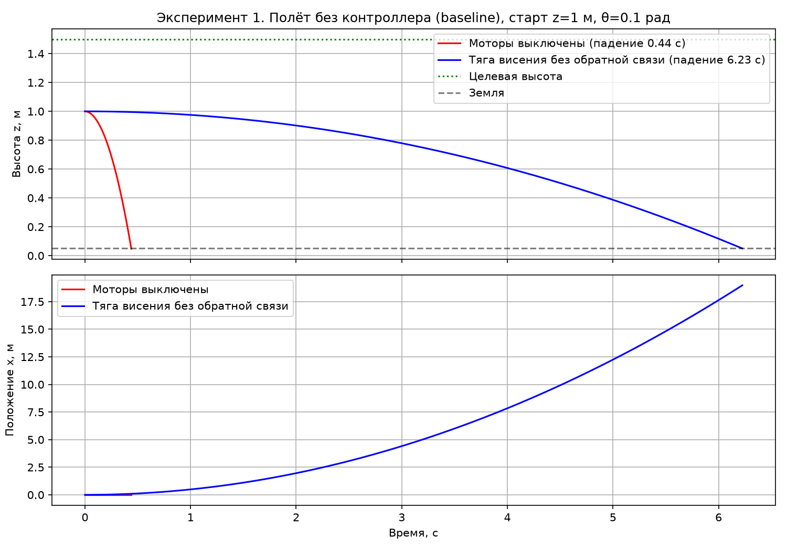
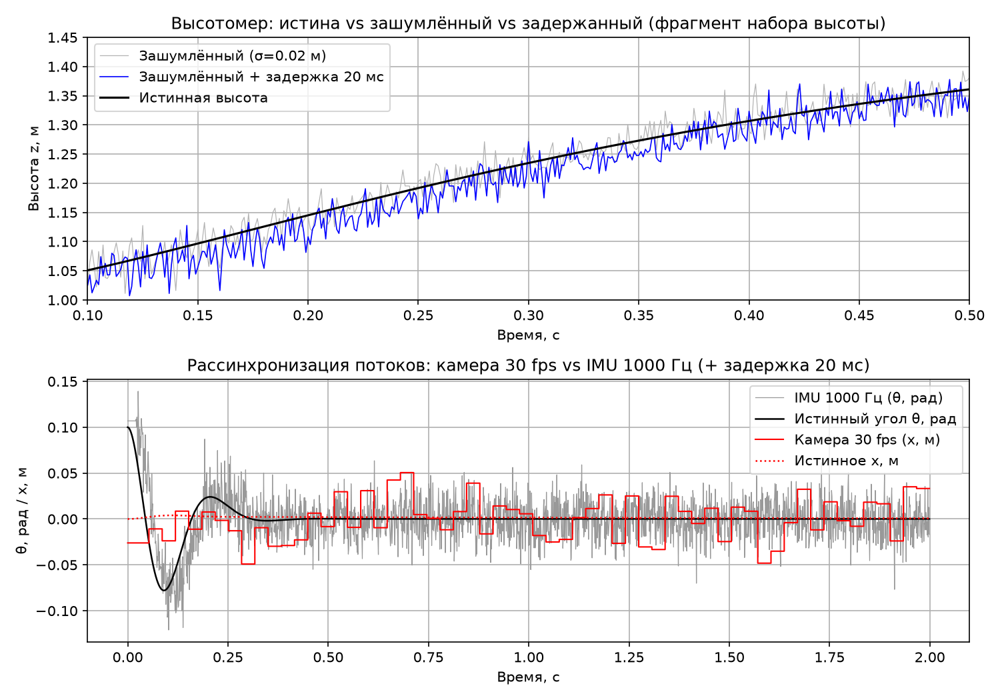
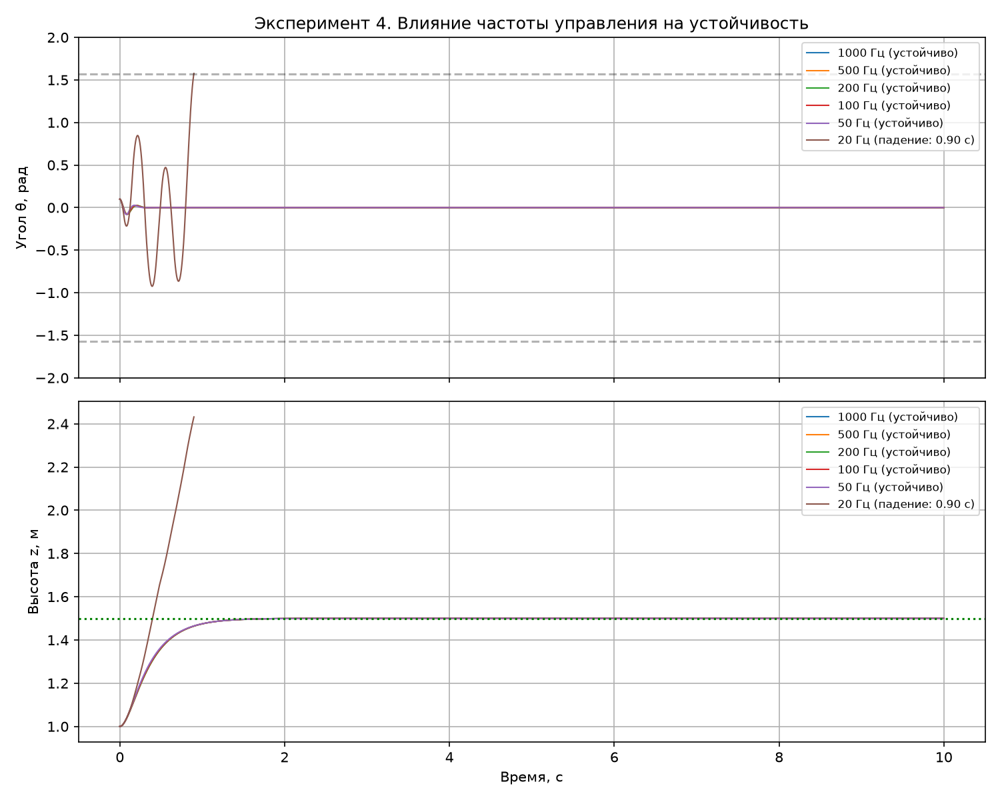
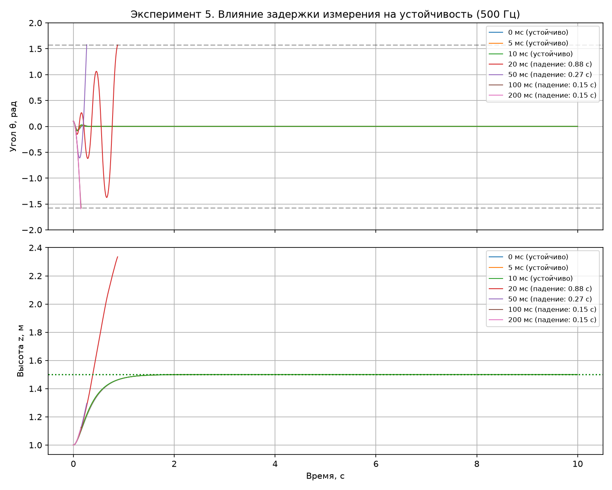
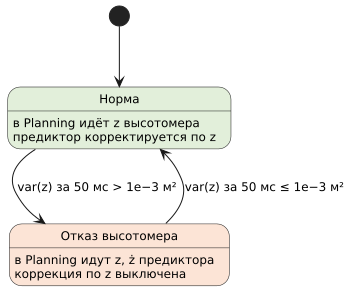
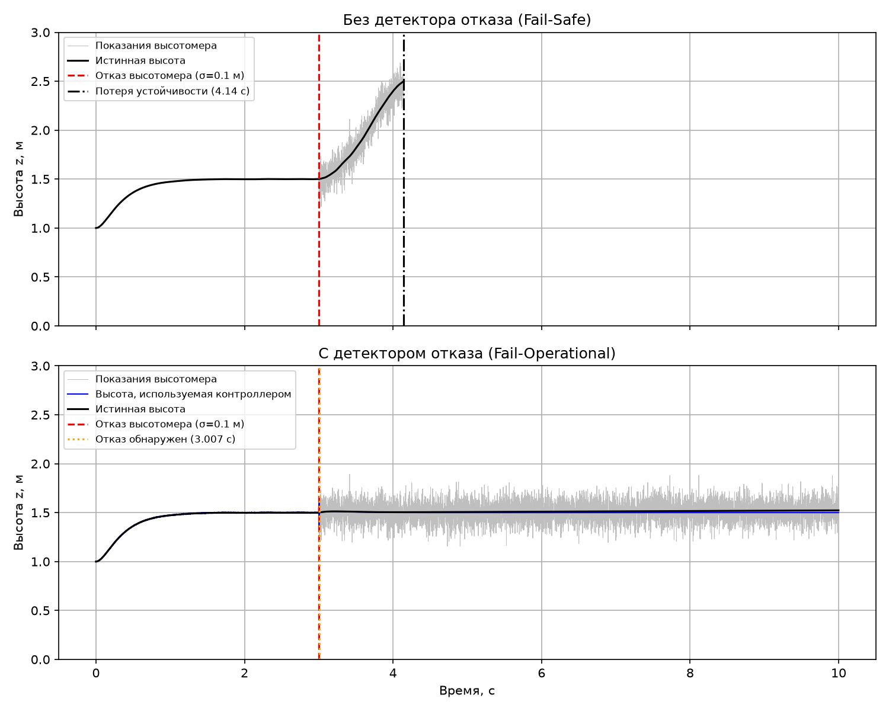
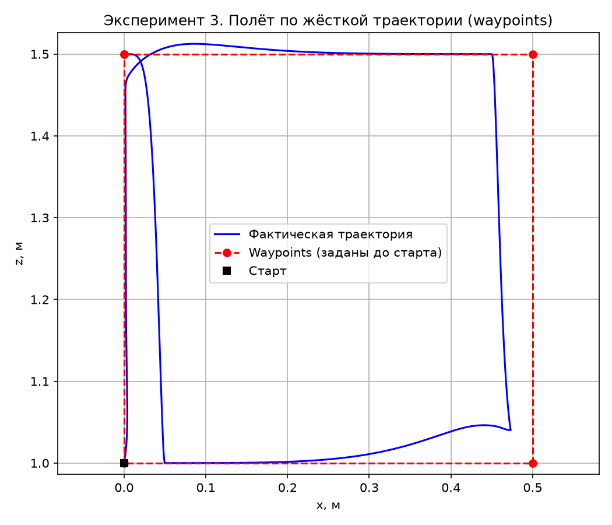

<div class="title-page">
<div class="tp-top">
<p>Дисциплина «Прикладное программирование»</p>
</div>
<div class="tp-center">
<p class="tp-kind">ОТЧЁТ<br>по лабораторной работе №1</p>
<p class="tp-name">«Первый контакт с физикой: настройка симуляции, слои Perception → Planning → Control и физический дедлайн»</p>
<p class="tp-variant">Индивидуальный вариант №10<br>2D-квадрокоптер: висение в точке, PD по высоте</p>
</div>
<div class="tp-right">
<p><b>Выполнил:</b> Цароев Альберт Казебкович</p>
<p><b>Группа:</b> ПИЖ-б-о-23-1(1)</p>
<p><b>IDE:</b> Visual Studio Code</p>
<p><b>Претендую на оценку:</b> «Отлично»</p>
<p><b>Проверил:</b> ______________________</p>
</div>
<div class="tp-bottom">
<p class="tp-repo">Репозиторий: <a href="https://github.com/Wildcat2k21/prikladnoe_programmirovanie">https://github.com/Wildcat2k21/prikladnoe_programmirovanie</a></p>
<p>2026</p>
</div>
</div>

<!-- TOC -->

## 1. Цель и задачи работы

**Цель работы** — закрепить на практике три фундаментальных тезиса лекции №1 о Physical AI:

1. **Физический дедлайн вместо бизнес-логического.** Почувствовать разницу между задержкой 200 мс, нормальной для веба, и 5–20 мс, допустимой для робота.
2. **Необратимость ошибки.** Увидеть, что падение в симуляции нельзя «откатить» без перезапуска эпизода.
3. **Отсутствие изоляции от среды.** Поработать с шумными, неполными и непрерывно меняющимися входными данными.

Дополнительно архитектура из трёх слоёв (Perception → Planning → Control) разбирается на собственной реализации, а не на схеме.

**Задачи работы:**

1. Развернуть среду симуляции MuJoCo и запустить модель без контроллера.
2. Реализовать слой **Perception**: извлечение состояния из симуляции, шум и задержку измерений.
3. Реализовать слой **Planning**: PD-регулятор, по варианту — PD по высоте, и жёсткую траекторию по waypoints.
4. Реализовать слой **Control**: контур управления с фиксированной частотой и эксперименты по частоте и задержке.
5. Собрать полный замкнутый контур и реализовать принцип **Fail-Operational** (детектор отказа сенсора).
6. Оформить отчёт с графиками, таблицами и ответами на контрольные вопросы.

**Индивидуальный вариант №10:** объект — 2D-квадрокоптер (вариант C методички), задача — висение в точке, особенность — PD-регулятор по высоте. Для вариантов 1–13 эксперименты по частоте и задержке (часть 4) обязательны, они выполнены в разделах 7–8.

## 2. Среда и инструменты

| Компонент          | Версия                              | Назначение                 |
| ------------------ | ----------------------------------- | -------------------------- |
| Python             | 3.14.4                              | язык реализации            |
| MuJoCo             | 3.17.0                              | физический движок          |
| NumPy              | 2.5.4                               | численные вычисления       |
| Matplotlib         | 3.11.2                              | графики                    |
| Jupyter Notebook   | 7.6.3                               | интерактивные эксперименты |
| Visual Studio Code | расширения Python, Pylance, Jupyter | IDE                        |

Выбрана **VS Code (вариант B методички)**: она легче PyCharm по памяти и уже использовалась для других задач. Зависимости установлены в виртуальное окружение `.venv` командой `pip install -r requirements.txt`. В системе не было пакета `python3-venv`, поэтому окружение создано с ключом `--without-pip`, а pip загружен официальным `get-pip.py`.

Структура проекта:

```text
lab1/models/quadrotor_2d.xml      модель 2D-квадрокоптера
lab1/src/perception.py            слой Perception
lab1/src/planning.py              слой Planning
lab1/src/control.py               слой Control, эпизод, эксперименты
lab1/src/fail_operational.py      детектор отказа и резерв по модели
lab1/src/main.py                  запуск всех экспериментов
lab1/notebooks/lab1_experiments.ipynb
reports/results.md, reports/figures/   результаты (генерируются main.py)
```

Все эксперименты воспроизводятся одной командой `python lab1/src/main.py`. Шум задаётся генератором с фиксированным зерном, поэтому повторный запуск даёт те же числа.

## 3. Модель объекта

Квадрокоптер движется в вертикальной плоскости XZ и имеет три степени свободы: горизонтальное положение `x`, высоту `z` и угол наклона `θ` (pitch). Рама массой 0.5 кг несёт два мотора на плече `l` = 0.15 м. Каждый мотор создаёт тягу вдоль собственной оси корпуса в диапазоне 0…10 Н.

| Параметр                           | Значение                                             |
| ---------------------------------- | ---------------------------------------------------- |
| Масса `m`                          | 0.613 кг                                             |
| Момент инерции `I`                 | 0.0064 кг·м²                                         |
| Плечо мотора `l`                   | 0.15 м                                               |
| Тяга висения одного мотора `m·g/2` | 3.01 Н                                               |
| Шаг физики                         | 1 мс (1000 Гц)                                       |
| Старт                              | x = 0, z = 1.0 м, θ = 0.1 рад (начальное возмущение) |
| Цель висения                       | (x, z) = (0, 1.5) м                                  |

Уравнения движения, которые решает MuJoCo:

```text
m·ẍ = (F_л + F_п)·sin θ
m·z̈ = (F_л + F_п)·cos θ − m·g
I·θ̈ = (F_л − F_п)·l
```

В исходной заготовке модели тяга была направлена вдоль оси Y (`gear="0 1 0 …"`), то есть вдоль оси вращения, и моторы ничего не поднимали. Ось исправлена на Z корпуса. Шаг физики уменьшен с 2 до 1 мс: физика должна идти не медленнее самой высокой исследуемой частоты управления. Иначе режим «1000 Гц» фактически работал бы на 500 Гц.

**Критерии потери устойчивости («падения»):** касание земли (z < 0.05 м), переворот (|θ| > π/2) или уход от точки висения дальше чем на 1 м.

## 4. Схема системы

<figure>

<figcaption>Рисунок 1 — Архитектура системы: три слоя и Fail-Operational</figcaption>
</figure>

Сенсоры работают на каждом шаге физики (1000 Гц), а контроллер забирает последнее доступное наблюдение на своей частоте. Это та же схема, что в реальном роботе: IMU непрерывно пишет в буфер, а контур управления читает его по таймеру.

**Perception** (`perception.py`) имитирует три сенсора:

- **IMU** даёт `θ` и `θ̇` с частотой 1000 Гц;
- **высотомер** даёт только `z`, поэтому вертикальная скорость `ż` вычисляется как производная высоты, сглаженная фильтром первого порядка с τ = 20 мс;
- **камера** даёт `x` и `ẋ` с частотой 30 кадров/с, между кадрами держится последнее значение.

Ко всем каналам добавляется гауссовский шум (`noisy_sensor`) и задержка на N шагов (`DelayedSensor`). В отличие от листинга методички, `DelayedSensor` допускает нулевую задержку и заполняет буфер первым измерением, а не нулями. С нулями высотомер в начале эпизода «видел» бы z = 0, и контроллер дал бы рывок тяги.

**Planning** (`planning.py`) реализует каскадный PD-регулятор (рисунок 2). Основной контур варианта №10 — PD по высоте с компенсацией силы тяжести и наклона:

```text
T = m · (g + Kp_z·(z* − z) − Kd_z·ż) / cos θ,    Kp_z = 25, Kd_z = 10
```

Квадрокоптер не может двигаться по x, не наклонившись. Поэтому внешний контур по x вычисляет желаемый угол θ\* (не более 0.4 рад), а быстрый внутренний контур по углу — момент τ. Его коэффициенты Kp = 1600 и Kd = 56 соответствуют собственной частоте ω ≈ 40 рад/с и демпфированию ζ ≈ 0.7. Микшер переводит пару (T, τ) в тяги моторов.

<figure>

<figcaption>Рисунок 2 — Каскадный PD-регулятор висения</figcaption>
</figure>

**Control** (`control.py`, класс `ControlLoop`) обновляет команду раз в `1/freq` секунд и держит её между обновлениями (zero-order hold). Тяги ограничиваются диапазоном 0…10 Н. Число шагов физики на один шаг управления считается через `round`, а не `int`: из-за погрешности float `int(0.005/0.001)` даёт 4 вместо 5.

**Fail-Operational** (`fail_operational.py`) — прослойка между Perception и Planning, подробно описана в разделе 9.

## 5. Эксперимент 1: полёт без контроллера (baseline)

Модель запущена в двух режимах без обратной связи. В первом моторы выключены. Во втором на оба мотора подана постоянная тяга висения 3.01 Н, рассчитанная заранее по массе.

<figure>

<figcaption>Рисунок 3 — Полёт без контроллера: высота и горизонтальное положение</figcaption>
</figure>

<p class="tcap">Таблица 1 — Результаты эксперимента без контроллера</p>

| Режим                                   | Время до падения | Причина                         |
| --------------------------------------- | ---------------- | ------------------------------- |
| Моторы выключены                        | 0.439 с          | удар о землю                    |
| Постоянная тяга висения 3.01 Н на мотор | 6.225 с          | удар о землю, снос по x на 19 м |

С выключенными моторами аппарат падает с высоты 0.95 м за 0.439 с, что совпадает с расчётом свободного падения √(2·0.95/9.81) = 0.440 с и подтверждает корректность модели. Точно рассчитанная тяга без обратной связи тоже не удерживает аппарат. Начальный наклон 0.1 рад отклоняет вектор тяги: горизонтальная составляющая разгоняет аппарат вбок, а вертикальной (cos 0.1 = 0.995) чуть не хватает на вес. Без измерений компенсировать возмущение невозможно.

**Частота шага физики:** timestep = 0.001 с, то есть 1000 Гц (в заготовке методички было 0.002 с = 500 Гц).

## 6. Слой Perception: шум, задержка, рассинхронизация

На рисунке 4 управление идёт по идеальным сенсорам, а параллельно записываются показания «реальных» сенсоров: шум σ = 0.02, задержка 20 мс, камера 30 кадров/с.

<figure>

<figcaption>Рисунок 4 — Истина, зашумлённый и задержанный сигнал (вверху); камера 30 кадров/с и IMU 1000 Гц (внизу)</figcaption>
</figure>

На верхнем графике задержанный сигнал (синий) систематически лежит ниже истинного при наборе высоты. Он сдвинут вправо на 20 мс, что при скорости около 0.6 м/с даёт ошибку около 1.2 см даже без учёта шума. На нижнем графике показания IMU плотно облегают истинный угол, а показания камеры идут ступеньками по 33 мс. В один и тот же момент контроллер получает угол почти из настоящего и положение из прошлого: данные о положении отстают на 20–53 мс, о наклоне — только на 20 мс.

## 7. Эксперимент 2: частота управления и устойчивость

Частота управления менялась от 1000 до 20 Гц при идеальных сенсорах. Чтобы найти критическую частоту, период управления дополнительно перебирался с шагом 1 мс. Для каждой устойчивой частоты определён **запас по задержке** — дополнительная задержка измерения, которую контур ещё выдерживает.

<figure>

<figcaption>Рисунок 5 — Влияние частоты управления на угол θ и высоту z</figcaption>
</figure>

<p class="tcap">Таблица 2 — Влияние частоты управления на устойчивость</p>

| Частота управления | Время до падения | Устойчиво? | Комментарий                                                   |
| ------------------ | ---------------- | ---------- | ------------------------------------------------------------- |
| 1000 Гц            | > 10 с (не упал) | Да         | Как Atlas. Запас по задержке 17 мс; θ установился за 0.26 с   |
| 500 Гц             | > 10 с (не упал) | Да         | Как Unitree. Запас по задержке 17 мс; θ установился за 0.26 с |
| 200 Гц             | > 10 с (не упал) | Да         | Веб-«нормально». Запас по задержке уже 15 мс                  |
| 100 Гц             | > 10 с (не упал) | Да         | Запас по задержке 13 мс                                       |
| 50 Гц              | > 10 с (не упал) | Да         | Запас по задержке 7 мс — на грани                             |
| 20 Гц              | 0.90 с           | Нет        | Раскачка по углу и переворот                                  |

**Критическая частота** — около 23 Гц: при периоде 43 мс (23.3 Гц) аппарат ещё висит, при 44 мс (22.7 Гц) переворачивается.

Без задержки и шума режимы 50–1000 Гц выглядят почти одинаково, а при 20 Гц аппарат за 0.9 с раскачивается и переворачивается. Деградация видна по запасу устойчивости: удержание команды на период T работает как скрытая задержка около T/2. Поэтому запас уменьшается с 17 мс (1000–500 Гц) до 15, 13 и 7 мс при 200, 100 и 50 Гц, то есть ровно на 2.5, 5 и 10 мс. Частота 200 Гц, отличная для веб-сервиса, уже «съедает» часть запаса, который понадобится при реальных задержках сенсоров.

## 8. Эксперимент 3: задержка и устойчивость

Частота управления зафиксирована на 500 Гц, задержка измерений вносилась в `DelayedSensor` во всех каналах.

<figure>

<figcaption>Рисунок 6 — Влияние задержки измерения на угол θ и высоту z (500 Гц)</figcaption>
</figure>

<p class="tcap">Таблица 3 — Влияние задержки на устойчивость (500 Гц)</p>

| Задержка | Время до падения | Устойчиво? | Комментарий                                                 |
| -------- | ---------------- | ---------- | ----------------------------------------------------------- |
| 0 мс     | > 10 с (не упал) | Да         | Перерегулирование по углу 0.078 рад                         |
| 5 мс     | > 10 с (не упал) | Да         | Перерегулирование 0.080 рад                                 |
| 10 мс    | > 10 с (не упал) | Да         | Перерегулирование 0.086 рад: колебательность растёт         |
| 20 мс    | 0.88 с           | Нет        | Переворот — «у Atlas задержка 20 мс — это падение с высоты» |
| 50 мс    | 0.27 с           | Нет        | Переворот                                                   |
| 100 мс   | 0.15 с           | Нет        | Переворот                                                   |
| 200 мс   | 0.15 с           | Нет        | Переворот: «нормальная» веб-задержка                        |

**Граница устойчивости** определена перебором с шагом 1 мс: при 17 мс аппарат ещё висит, при 18 мс переворачивается. Задержка τ снижает запас по фазе контура ориентации на ω·τ. При частоте среза около 40–50 рад/с и τ = 20 мс это 0.8–1 рад (45–57°), почти весь запас PD-регулятора. Колебания на рисунке 6 при 20 мс нарастают от периода к периоду: контроллер реагирует на состояние, которого уже нет, и каждый раз «толкает» не туда.

## 9. Эксперимент 4: Fail-Operational

**Сценарий отказа.** В момент t = 3 с, когда аппарат уже висит, шум высотомера скачком вырастает с номинальных 0.002 м до σ = 0.1 м. Вертикальная скорость получается дифференцированием высоты, поэтому шум многократно усиливается и через Kd попадает в тягу.

**Детектор отказа** (`SensorFailureDetector`) считает дисперсию показаний высотомера в скользящем окне из 50 шагов (50 мс). Если она превышает порог 10⁻³ м², сенсор признаётся отказавшим. Порог выбран между характерными значениями: номинальный шум даёт около 4·10⁻⁶ м², подъём со скоростью 0.5 м/с — около 2·10⁻⁴ м², отказ с σ = 0.1 м — около 10⁻² м².

**Резервный источник** (`ModelPredictor`) — наблюдатель на модели динамики z̈ = T·cos θ / m − g. Командная тяга T известна бортовому компьютеру, а угол θ даёт исправный IMU. Пока высотомер исправен, оценка корректируется по его показаниям, а при отказе оценка высоты строится только по модели (dead reckoning). Предиктор не использует истинное состояние симулятора, которого у реального робота нет.

<figure>

<figcaption>Рисунок 7 — Переключение источника высоты</figcaption>
</figure>

<figure>

<figcaption>Рисунок 8 — Отказ высотомера в t = 3 с: без детектора (вверху) и с детектором (внизу)</figcaption>
</figure>

<p class="tcap">Таблица 4 — Сравнение режимов при отказе высотомера (σ = 0.1 м)</p>

| Режим                                  | Время до падения при шуме σ = 0.1 | Комментарий                                                                                    |
| -------------------------------------- | --------------------------------- | ---------------------------------------------------------------------------------------------- |
| Без детектора отказа                   | 4.14 с                            | Fail-Safe: система падает. Через 1.1 с после отказа аппарат уходит от точки                    |
| С детектором отказа                    | > 10 с (не упал)                  | Fail-Operational: система продолжает работу. Отказ обнаружен через 7 мс, ошибка висения 2.1 см |
| С детектором, ошибка массы в модели 2% | 6.09 с                            | Деградация: резерв по модели дрейфует, но даёт 3 с на безопасную посадку                       |

<p class="tcap">Таблица 5 — Зависимость от силы отказа</p>

| σ отказа, м | Без детектора | Итог           | С детектором | Итог                                    |
| ----------- | ------------- | -------------- | ------------ | --------------------------------------- |
| 0.02        | > 10 с        | ошибка 3.7 см  | > 10 с       | ошибка 3.7 см (детектор не срабатывает) |
| 0.05        | > 10 с        | ошибка 29.2 см | > 10 с       | ошибка 18.3 см (срабатывает не всегда)  |
| 0.1         | 4.14 с        | уход от точки  | > 10 с       | ошибка 2.1 см                           |
| 0.2         | 3.75 с        | уход от точки  | > 10 с       | ошибка 2.1 см                           |
| 0.5         | 3.66 с        | уход от точки  | > 10 с       | ошибка 2.1 см                           |
| 1.0         | 3.65 с        | уход от точки  | > 10 с       | ошибка 2.1 см                           |

Без детектора аппарат не падает вниз, а **улетает вверх**. Шум, усиленный производной, загоняет моторы в ограничения 0 и 10 Н. Эти пределы несимметричны относительно тяги висения 3 Н, поэтому средняя тяга оказывается больше веса. Ни одного исключения в программе при этом не возникло. С детектором переключение произошло через 7 мс, и аппарат продолжил висеть с ошибкой 2 см: она набралась за миллисекунды до срабатывания и сохраняется, потому что модель без коррекции уже не может её заметить.

Строка с ошибкой модели в 2% показывает предел подхода: резерв по модели дрейфует (ошибка ускорения 0.2 м/с²), и через 3 с аппарат уходит от точки. Fail-Operational не делает отказ безвредным, он даёт время на деградированный режим, например на посадку. Таблица 5 показывает и границу детектора: при σ = 0.05 м дисперсия колеблется около порога, переключения срабатывают нестабильно. В реальной системе лучше анализировать невязку «измерение минус предсказание», а не сам сигнал.

## 10. Ответы на контрольные вопросы

**1. Почему частота физики в MuJoCo — 500 Гц, а не 60 Гц, как частота монитора?**
Монитор показывает картинку человеку, а физика интегрирует уравнения движения. Явный интегратор корректен, только если шаг намного меньше времени самой быстрой динамики. У контура ориентации ω ≈ 40 рад/с, и при шаге 16.7 мс на один период колебания приходится меньше 10 шагов. Кроме того, физика должна идти быстрее управления: при контуре 500–1000 Гц, как у Atlas с дедлайном 1–2 мс, физика 60 Гц пропускала бы десятки команд. Поэтому в работе шаг физики уменьшен до 1 мс. Эксперимент 2 показывает, что обновление команды раз в 50 мс уже роняет аппарат за 0.9 с.

**2. Как проявляется рассинхронизация потоков данных (камера 30 fps, IMU 1000 Гц) на графике «истина vs. зашумлённый vs. задержанный»?**
На рисунке 4 IMU-кривая плотно облегает истинный угол, а камера даёт ступеньки по 33 мс. С учётом задержки 20 мс данные о положении отстают на 20–53 мс, о наклоне — на 20 мс. Контроллер собирает состояние из кусков, относящихся к разным моментам времени. Поэтому медленный сенсор допустим только во внешнем медленном контуре (x → θ\*), а быстрый контур ориентации обязан питаться от IMU.

**3. В чём разница между «жёсткой траекторией до старта» (Atlas) и «перестраиваемой картой мира в реальном времени» (Optimus)?**
Жёсткая траектория рассчитывается заранее, и робот только отслеживает её: это дёшево и предсказуемо, но мир считается неизменным. Перестраиваемая карта обновляется Perception на каждом цикле, и Planning пересчитывает путь: так можно работать в незнакомой среде, но это дороже по вычислениям. На рисунке 9 (приложение Б) маршрут из пяти точек задан до старта и проходится, потому что мир пуст. Подход ломается, если в пролёт между точками (0.5; 1.5) и (0.5; 1.0) войдёт человек или откроется дверь: жёсткий план о препятствии не знает.

**4. При какой задержке в вашей системе аппарат падает?**
При 500 Гц граница — 17–18 мс; задержка 20 мс приводит к перевороту за 0.88 с. Это прямое подтверждение фразы «у Atlas задержка 20 мс — это падение с высоты». Причина в потере запаса по фазе ω·τ ≈ 45–57°. Веб-задержка 200 мс роняет аппарат за 0.15 с.

**5. Что такое Fail-Operational? Чем он отличается от Fail-Safe?**
Fail-Safe при отказе переводит систему в безопасное состояние — останавливает. Fail-Operational продолжает работу в деградированном режиме. Летающему и шагающему роботу нужен второй вариант, потому что «остановиться» для него не значит «безопасно»: выключенные моторы — это удар о землю через 0.44 с (эксперимент 1). Шагающий робот вроде ANYmal при повреждении ноги должен продолжать идти, перестроив походку, а Unitree после толчка должен удержать равновесие, а не отключиться. В работе без детектора аппарат теряет точку через 1.1 с после отказа, с детектором — висит до конца эпизода.

**6. Почему в Physical AI нельзя использовать try/except вокруг падения робота?**
`try/except` перехватывает исключение в программе, а падение происходит в мире. В эксперименте 4 без детектора код отработал без единого исключения, а аппарат улетел. Когда что-то можно «поймать», импульс уже набран, а у механики нет отката. В симуляции падение отменяет только `mj_resetData`, то есть новый эпизод, а у реального робота такой функции нет. Ошибку нужно предотвращать до того, как она станет физической.

**7. В чём разница между бизнес-дедлайном (SLA) и физическим дедлайном?**
SLA — статистическое обещание вида «99.9% запросов быстрее 200 мс»: опоздавший запрос означает недовольного пользователя и повторную попытку. Физический дедлайн задаёт динамика объекта, и один пропуск может быть фатален. В работе задержка 10 мс даёт устойчивое висение, 18 мс — переворот. Разница в 8 мс, незаметная для веба, отделяет «работает» от «разбился».

**8. Почему все системы из лекции — Edge AI, а не облачные решения?**
Сетевой обмен с облаком занимает 20–200 мс без гарантий, а граница устойчивости в работе — 17 мс. При задержках 50–200 мс аппарат переворачивается за 0.15–0.27 с, и связь к тому же может пропасть. Edge AI ограничивает архитектуру по вычислениям, памяти и энергии. Время выполнения быстрого контура должно быть детерминированным: без сети и пауз сборщика мусора. Нужна иерархия, в которой быстрые простые контуры работают на 500–1000 Гц, а сложное планирование — реже. Отказоустойчивость тоже обязана жить на борту.

**9. Как выбор IDE повлиял на скорость отладки?**
В работе использовалась VS Code с расширениями Python, Pylance и Jupyter. Самыми полезными оказались четыре функции. Отладчик с точками останова в цикле `run_episode` показывает `data.qpos`, `data.ctrl` и формы массивов NumPy на нужном шаге: например, так проверяется, что тяга правого мотора даёт отрицательное угловое ускорение. Jupyter-ноутбук позволяет перерисовать график без повторного запуска всех экспериментов. Pylance подсказывает API MuJoCo, а встроенный терминал работает с окружением `.venv`. VS Code легче PyCharm, но расширения пришлось ставить вручную.

**10. Почему «код в Physical AI не бросает исключений — он ломает оборудование»?**
Ответ дан в разделе 11 «Рефлексия».

## 11. Рефлексия

Обычная программа при ошибке останавливается и сообщает о ней, а мир вокруг остаётся прежним. Программа робота при ошибке продолжает выполняться и аккуратно выдаёт моторам неправильные команды. Последствия наступают через физику, а не через сообщение в логе. В этой работе ни один отказ не вызвал исключения. Задержка 18 мс вместо 10 — Python отработал «успешно», а квадрокоптер перевернулся меньше чем за секунду. Отказавший высотомер выдавал правдоподобные числа с шумом, и без детектора аппарат улетел через 1.1 с. Ещё на этапе проверки исходной заготовки cart-pole выяснилось, что PD-регулятор с неверным знаком «работал» без ошибок, хотя маятник падал за 0.42 с при любой частоте управления. Корректность в Physical AI проверяется не пустым логом ошибок, а поведением системы в физическом времени. Защищаться приходится заранее: ограничением команд, детекторами отказов, резервными источниками данных и запасом по дедлайну.

## 12. Выводы

1. Среда MuJoCo развёрнута, модель 2D-квадрокоптера исправлена и проверена: время свободного падения совпало с расчётом (0.439 с против 0.440 с).
2. Слой Perception имитирует шум, задержку и рассинхронизацию сенсоров (IMU 1000 Гц, камера 30 кадров/с, высотомер с вычисляемой скоростью).
3. Каскадный регулятор с PD по высоте стабилизирует висение в точке при частоте управления от 50 до 1000 Гц, то есть и при 500+ Гц. Критическая частота — около 23 Гц.
4. Граница устойчивости по задержке при 500 Гц — 17 мс. Задержка 20 мс приводит к перевороту, что подтверждает тезис лекции о физическом дедлайне. Снижение частоты управления уменьшает запас по задержке примерно на половину периода.
5. Детектор отказа по дисперсии и резерв по модели обеспечивают Fail-Operational: при отказе высотомера аппарат продолжает висеть с ошибкой 2 см, а без детектора уходит от точки через 1.1 с. При ошибке модели 2% резерв лишь даёт время на посадку.

<div class="page-break"></div>

## Приложение А. Листинг кода

Полный код, включая `main.py` (запуск экспериментов, графики и таблицы) и Jupyter-ноутбук, находится в репозитории проекта. Ниже приведены модель и модули трёх слоёв.

<!-- LISTINGS:START -->
<div class="listings"></div>

### А.1. `lab1/models/quadrotor_2d.xml`

```xml
<mujoco model="quadrotor_2d">
  <!--
    2D-квадрокоптер (вариант №10: висение в точке, PD по высоте).
    Движение в плоскости XZ: x (slide), z (slide), pitch (hinge вокруг Y).
    Шаг физики 1 мс (1000 Гц): частота физики должна быть не ниже самой
    высокой исследуемой частоты управления (1000 Гц).
  -->
  <option timestep="0.001" gravity="0 0 -9.81"/>
  <worldbody>
    <light diffuse=".5 .5 .5" pos="0 0 5" dir="0 0 -1"/>
    <geom name="floor" type="plane" size="10 10 0.1" rgba="0.9 0.9 0.9 1"/>

    <!-- qpos = [x, z, pitch] совпадает с мировыми координатами центра масс -->
    <body name="quadrotor" pos="0 0 0">
      <joint name="x" type="slide" axis="1 0 0"/>
      <joint name="z" type="slide" axis="0 0 1"/>
      <joint name="pitch" type="hinge" axis="0 1 0"/>

      <geom name="frame" type="box" size="0.15 0.02 0.02" rgba="0.2 0.2 0.8 1" mass="0.5"/>

      <!-- Левый мотор, плечо 0.15 м -->
      <body name="left_motor" pos="-0.15 0 0">
        <geom type="cylinder" size="0.03 0.01" rgba="0.8 0.2 0.2 1"/>
        <site name="left_thrust" pos="0 0 0.01" size="0.01"/>
      </body>

      <!-- Правый мотор, плечо 0.15 м -->
      <body name="right_motor" pos="0.15 0 0">
        <geom type="cylinder" size="0.03 0.01" rgba="0.2 0.8 0.2 1"/>
        <site name="right_thrust" pos="0 0 0.01" size="0.01"/>
      </body>
    </body>
  </worldbody>

  <actuator>
    <!-- Тяга вдоль локальной оси Z мотора (вверх по корпусу), 0..10 Н -->
    <motor name="left" site="left_thrust" ctrlrange="0 10" ctrllimited="true" gear="0 0 1 0 0 0"/>
    <motor name="right" site="right_thrust" ctrlrange="0 10" ctrllimited="true" gear="0 0 1 0 0 0"/>
  </actuator>
</mujoco>
```

### А.2. `lab1/src/perception.py`

```python
"""
Слой Perception (Восприятие) — 2D-квадрокоптер
================================================
Извлечение состояния из симуляции, добавление шума и задержки.

Сенсоры борта:
- IMU (гироскоп + акселерометр): угол pitch и угловая скорость, частота физики;
- высотомер (барометр/дальномер): только высота z, вертикальная скорость
  оценивается как отфильтрованная производная высоты;
- позиционный сенсор (камера/оптический поток): x и x_dot, может работать
  на пониженной частоте (например, 30 fps) — рассинхронизация потоков.

Демонстрирует:
- шумные, неполные и непрерывно меняющиеся входные данные;
- рассинхронизацию потоков данных (камера 30 fps vs IMU 1000 Гц).
"""

import numpy as np
from collections import deque


def noisy_sensor(true_value, sigma=0.02, rng=np.random):
    """Аддитивный гауссовский шум (п. 2.2 методички)."""
    return true_value + rng.normal(0, sigma)


class DelayedSensor:
    """
    Задержка измерения на delay_steps шагов (п. 2.3 методички).

    Отличия от листинга в методичке:
    - delay_steps=0 допустим (в методичке deque(maxlen=0) падает);
    - буфер заполняется первым измерением, а не нулями — иначе в начале
      эпизода высотомер «видит» z=0 и контроллер даёт рывок тяги.
    """

    def __init__(self, delay_steps):
        self.delay_steps = delay_steps
        self.buffer = deque(maxlen=delay_steps + 1)

    def read(self, value):
        if not self.buffer:
            self.buffer.extend([value] * (self.delay_steps + 1))
        self.buffer.append(value)
        return self.buffer[0]


class SampleAndHold:
    """Сенсор с собственной частотой: между отсчётами выдаёт последнее значение."""

    def __init__(self, period_steps):
        self.period_steps = max(1, period_steps)
        self.counter = 0
        self.value = None

    def read(self, value):
        if self.value is None or self.counter % self.period_steps == 0:
            self.value = value
        self.counter += 1
        return self.value


class PerceptionLayer:
    """
    Полный слой восприятия 2D-квадрокоптера.

    Вызывается на каждом шаге физики (сенсоры работают непрерывно),
    контроллер забирает последнее доступное наблюдение на своей частоте.

    Возвращает dict с ключами x, z, theta, x_dot, z_dot, theta_dot
    (измеренные) и *_true (истинные, только для графиков).
    """

    def __init__(self, sim_dt, delay_steps=0, sigma_imu=0.0, sigma_alt=0.0,
                 sigma_pos=0.0, pos_rate_hz=None, z_dot_tau=0.02, seed=0):
        """
        Args:
            sim_dt: шаг физики, с
            delay_steps: задержка всех каналов в шагах физики
            sigma_imu: шум IMU (рад, рад/с)
            sigma_alt: шум высотомера (м)
            sigma_pos: шум позиционного сенсора (м, м/с)
            pos_rate_hz: частота позиционного сенсора (None = частота физики)
            z_dot_tau: постоянная времени фильтра производной высоты, с
            seed: зерно генератора шума (воспроизводимость экспериментов)
        """
        self.sim_dt = sim_dt
        self.delay_steps = delay_steps
        self.sigma_imu = sigma_imu
        self.sigma_alt = sigma_alt
        self.sigma_pos = sigma_pos
        self.rng = np.random.default_rng(seed)

        # Отказ высотомера: с момента fault_time шум становится fault_sigma
        self.fault_time = None
        self.fault_sigma = 0.0

        self.channels = ('x', 'z', 'theta', 'x_dot', 'z_dot', 'theta_dot')
        self.delays = {name: DelayedSensor(delay_steps) for name in self.channels}

        period = 1 if pos_rate_hz is None else round(1.0 / pos_rate_hz / sim_dt)
        self.pos_hold = {name: SampleAndHold(period) for name in ('x', 'x_dot')}

        # Оценка z_dot: производная высоты через фильтр 1-го порядка
        self.alpha = sim_dt / max(z_dot_tau, sim_dt)
        self.z_prev = None
        self.z_dot_est = 0.0

    def inject_altimeter_fault(self, fault_time, fault_sigma):
        """Запланировать отказ высотомера (резкий рост шума)."""
        self.fault_time = fault_time
        self.fault_sigma = fault_sigma

    def altimeter_sigma(self, t):
        if self.fault_time is not None and t >= self.fault_time:
            return self.fault_sigma
        return self.sigma_alt

    def observe(self, data):
        """
        Извлечь состояние из MjData и добавить шум/задержку.

        Args:
            data: объект mujoco.MjData

        Returns:
            dict с измеренными и истинными значениями
        """
        x_true, z_true, theta_true = data.qpos[0], data.qpos[1], data.qpos[2]
        x_dot_true, z_dot_true, theta_dot_true = data.qvel[0], data.qvel[1], data.qvel[2]

        # IMU — на частоте физики
        theta = noisy_sensor(theta_true, self.sigma_imu, self.rng)
        theta_dot = noisy_sensor(theta_dot_true, self.sigma_imu, self.rng)

        # Высотомер меряет только z; z_dot — отфильтрованная производная
        z = noisy_sensor(z_true, self.altimeter_sigma(data.time), self.rng)
        if self.z_prev is not None:
            z_dot_raw = (z - self.z_prev) / self.sim_dt
            self.z_dot_est += self.alpha * (z_dot_raw - self.z_dot_est)
        self.z_prev = z
        z_dot = self.z_dot_est

        # Позиционный сенсор — возможно, на пониженной частоте
        x = self.pos_hold['x'].read(noisy_sensor(x_true, self.sigma_pos, self.rng))
        x_dot = self.pos_hold['x_dot'].read(noisy_sensor(x_dot_true, self.sigma_pos, self.rng))

        measured = {'x': x, 'z': z, 'theta': theta,
                    'x_dot': x_dot, 'z_dot': z_dot, 'theta_dot': theta_dot}
        obs = {name: self.delays[name].read(measured[name]) for name in self.channels}

        obs.update({
            'x_true': x_true, 'z_true': z_true, 'theta_true': theta_true,
            'x_dot_true': x_dot_true, 'z_dot_true': z_dot_true,
            'theta_dot_true': theta_dot_true,
            'z_raw': z,  # зашумлённое, но не задержанное (для графика 2.4)
        })
        return obs
```

### А.3. `lab1/src/planning.py`

```python
"""
Слой Planning (Планирование) — 2D-квадрокоптер
================================================
Вариант №10: висение в точке, PD по высоте.

Каскадная схема:
    1. PD по высоте      z  -> суммарная тяга T            (основной контур варианта)
    2. PD по положению   x  -> желаемый угол theta_des     (медленный внешний контур)
    3. PD по углу    theta  -> момент tau                  (быстрый внутренний контур)
    4. Микшер (T, tau) -> тяги левого/правого моторов

Демонстрирует:
- численный решатель вместо if-else: управление — это решение уравнений
  динамики m*z'' = T*cos(theta) - m*g и I*theta'' = tau;
- жёсткую траекторию по waypoints (п. 3.3, Atlas) против перестраиваемой цели.
"""

import numpy as np

G = 9.81


def quadrotor_params(model):
    """Масса, момент инерции по pitch и плечо моторов из MjModel."""
    body = model.body('quadrotor').id
    mass = model.body_subtreemass[body]
    left, right = model.body('left_motor').id, model.body('right_motor').id
    arm = abs(model.body_pos[right][0])
    # I_yy рамы + моторы (собственная инерция + m*r^2)
    inertia = model.body_inertia[body][1]
    for motor in (left, right):
        inertia += model.body_inertia[motor][1] + model.body_mass[motor] * arm ** 2
    return mass, inertia, arm


class HoverPDPlanner:
    """
    Каскадный PD-регулятор висения в точке (x_target, z_target).

    PD по высоте с компенсацией гравитации и наклона:
        T = m * (g + Kp_z*(z* - z) - Kd_z*z_dot) / cos(theta)
    """

    def __init__(self, mass, inertia, arm,
                 Kp_z=25.0, Kd_z=10.0,
                 Kp_x=1.0, Kd_x=1.5, theta_max=0.4,
                 Kp_theta=1600.0, Kd_theta=56.0,
                 thrust_max=10.0):
        """
        Args:
            mass, inertia, arm: параметры аппарата (см. quadrotor_params)
            Kp_z, Kd_z: PD по высоте (w ~ 5 рад/с, zeta = 1)
            Kp_x, Kd_x: PD по горизонтали -> желаемый угол
            theta_max: ограничение желаемого угла, рад
            Kp_theta, Kd_theta: PD по углу (w ~ 40 рад/с, zeta ~ 0.7)
            thrust_max: максимальная тяга одного мотора, Н
        """
        self.mass, self.inertia, self.arm = mass, inertia, arm
        self.Kp_z, self.Kd_z = Kp_z, Kd_z
        self.Kp_x, self.Kd_x = Kp_x, Kd_x
        self.theta_max = theta_max
        self.Kp_theta, self.Kd_theta = Kp_theta, Kd_theta
        self.thrust_max = thrust_max

    def hover_thrust(self):
        """Тяга одного мотора для висения, Н."""
        return self.mass * G / 2

    def compute(self, obs, target):
        """
        Вычислить тяги моторов.

        Args:
            obs: dict из PerceptionLayer (или FailOperationalEstimator)
            target: (x_target, z_target)

        Returns:
            (np.array([F_left, F_right]), T_total): тяги моторов и суммарная тяга
        """
        x_t, z_t = target
        theta = obs['theta']

        # Внешний контур по x: наклон theta>0 даёт ускорение в +x
        theta_des = self.Kp_x * (x_t - obs['x']) - self.Kd_x * obs['x_dot']
        theta_des = np.clip(theta_des, -self.theta_max, self.theta_max)

        # PD по высоте (суть варианта №10)
        a_z = self.Kp_z * (z_t - obs['z']) - self.Kd_z * obs['z_dot']
        thrust = self.mass * (G + a_z) / max(np.cos(theta), 0.3)

        # Внутренний контур по углу
        tau = self.inertia * (self.Kp_theta * (theta_des - theta)
                              - self.Kd_theta * obs['theta_dot'])

        # Микшер: тяга правого мотора даёт отрицательный момент по pitch
        f_left = thrust / 2 + tau / (2 * self.arm)
        f_right = thrust / 2 - tau / (2 * self.arm)
        forces = np.clip([f_left, f_right], 0.0, self.thrust_max)
        return forces, forces.sum()


class WaypointPlanner:
    """
    Жёсткая траектория по waypoints (п. 3.3, вариант C).

    Траектория задаётся до старта и не перестраивается — как у Atlas.
    Переход к следующей точке происходит при попадании в радиус tolerance.
    """

    def __init__(self, waypoints, tolerance=0.05):
        """
        Args:
            waypoints: list of (x, z)
            tolerance: радиус достижения точки, м
        """
        self.waypoints = list(waypoints)
        self.tolerance = tolerance
        self.current_idx = 0

    def get_target(self, x, z):
        """Текущая целевая точка и флаг «маршрут пройден»."""
        target = self.waypoints[self.current_idx]
        if np.hypot(x - target[0], z - target[1]) < self.tolerance \
                and self.current_idx < len(self.waypoints) - 1:
            self.current_idx += 1
            target = self.waypoints[self.current_idx]
        return target, self.current_idx == len(self.waypoints) - 1
```

### А.4. `lab1/src/control.py`

```python
"""
Слой Control (Управление и исполнение) — 2D-квадрокоптер
==========================================================
Контур управления с фиксированной частотой и эксперименты
по частоте и задержке (часть 4 методички).

Демонстрирует:
- физический дедлайн: команда обновляется раз в 1/freq с, между
  обновлениями мотор держит старую команду (zero-order hold);
- необратимость ошибки: после «падения» эпизод можно только перезапустить.
"""

import mujoco
import numpy as np

from perception import PerceptionLayer
from planning import HoverPDPlanner, quadrotor_params

# Начальное состояние и цель висения (общие для всех экспериментов)
START = {'x': 0.0, 'z': 1.0, 'theta': 0.1}   # старт с наклоном 0.1 рад
TARGET = (0.0, 1.5)                          # точка висения (x, z), м

# Критерии потери устойчивости («падения»)
Z_GROUND = 0.05        # касание земли, м
THETA_FLIP = np.pi / 2 # переворот, рад
MAX_DEVIATION = 1.0    # улёт от точки висения, м


def reset(model, data, start=START):
    """Сброс эпизода — единственный способ «откатить» падение."""
    mujoco.mj_resetData(model, data)
    data.qpos[:] = [start['x'], start['z'], start['theta']]
    mujoco.mj_forward(model, data)


def failure_reason(data, target, check_deviation=True):
    """Причина потери устойчивости или None, если полёт продолжается."""
    x, z, theta = data.qpos
    if z < Z_GROUND:
        return 'удар о землю'
    if abs(theta) > THETA_FLIP:
        return 'переворот'
    if check_deviation and np.hypot(x - target[0], z - target[1]) > MAX_DEVIATION:
        return 'улёт от точки'
    return None


class ControlLoop:
    """
    Контур управления с заданной частотой.

    Физический дедлайн:
    - Atlas: 500-1000 Гц (1-2 мс)
    - Unitree: 500 Гц
    - «веб-нормально»: 200 Гц и ниже
    """

    def __init__(self, model, freq_hz=500):
        """
        Args:
            model: объект mujoco.MjModel
            freq_hz: частота обновления управления, Гц
        """
        self.model = model
        self.freq_hz = freq_hz
        self.sim_dt = model.opt.timestep
        # round, а не int: int(0.005 / 0.001) == 4 из-за погрешности float
        self.steps_per_control = max(1, round(1.0 / freq_hz / self.sim_dt))

    def is_control_step(self, step):
        return step % self.steps_per_control == 0

    def apply(self, data, forces):
        """Записать команду в исполнительные механизмы (держится до следующего обновления)."""
        data.ctrl[:] = forces

    def step_physics(self, data):
        mujoco.mj_step(self.model, data)


def run_episode(model, data, freq_hz=500, perception=None, planner=None,
                estimator=None, target=TARGET, sim_time=10.0,
                waypoints=None, open_loop_forces=None, start=START):
    """
    Полный замкнутый контур: Perception -> [Fail-Operational] -> Planning -> Control.

    Args:
        freq_hz: частота контура управления
        perception: PerceptionLayer (по умолчанию — идеальные сенсоры)
        planner: HoverPDPlanner (по умолчанию — штатные коэффициенты)
        estimator: FailOperationalEstimator или None (режим без детектора)
        waypoints: WaypointPlanner или None (висение в target)
        open_loop_forces: если задано — контроллер выключен, на моторы
            подаётся постоянная тяга (baseline, эксперимент 1)

    Returns:
        dict с логами и временем потери устойчивости fall_time
        (sim_time, если аппарат продержался весь эпизод)
    """
    reset(model, data, start)
    loop = ControlLoop(model, freq_hz)
    if perception is None:
        perception = PerceptionLayer(loop.sim_dt)
    if planner is None:
        planner = HoverPDPlanner(*quadrotor_params(model))

    log = {k: [] for k in ('t', 'x', 'z', 'theta', 'z_meas', 'z_used',
                           'f_left', 'f_right', 'fault_flag', 'target_x', 'target_z')}
    forces, thrust = np.zeros(2), 0.0
    current_target = target
    fall_time, reason = sim_time, None
    fault_flag = False

    for step in range(int(round(sim_time / loop.sim_dt))):
        t = step * loop.sim_dt

        # Perception: сенсоры работают на каждом шаге физики
        obs = perception.observe(data)
        used = obs
        if estimator is not None:
            used, fault_flag = estimator.update(obs, thrust)

        # Planning + Control: только в моменты обновления контура
        if open_loop_forces is not None:
            forces = np.asarray(open_loop_forces, dtype=float)
        elif loop.is_control_step(step):
            if waypoints is not None:
                current_target, _ = waypoints.get_target(used['x'], used['z'])
            forces, thrust = planner.compute(used, current_target)
        loop.apply(data, forces)
        loop.step_physics(data)

        log['t'].append(t)
        log['x'].append(data.qpos[0])
        log['z'].append(data.qpos[1])
        log['theta'].append(data.qpos[2])
        log['z_meas'].append(obs['z'])
        log['z_used'].append(used['z'])
        log['f_left'].append(forces[0])
        log['f_right'].append(forces[1])
        log['fault_flag'].append(fault_flag)
        log['target_x'].append(current_target[0])
        log['target_z'].append(current_target[1])

        # Без контроллера «улёт от точки» не считаем — ждём физического падения
        reason = failure_reason(data, target if waypoints is None else current_target,
                                check_deviation=open_loop_forces is None)
        if reason is not None:
            fall_time = t
            break

    log = {k: np.array(v) for k, v in log.items()}
    log['fall_time'] = fall_time
    log['reason'] = reason
    log['stable'] = reason is None
    # Ошибка висения за последнюю секунду (для устойчивых режимов)
    tail = log['t'] >= log['t'][-1] - 1.0
    log['hover_error'] = float(np.mean(np.hypot(log['x'][tail] - target[0],
                                                log['z'][tail] - target[1])))
    log['theta_rms'] = float(np.sqrt(np.mean(log['theta'][tail] ** 2)))
    # Качество переходного процесса по углу: установление в |theta| < 0.01 рад
    # и перерегулирование (максимальный выброс в сторону, противоположную старту)
    outside = np.nonzero(np.abs(log['theta']) > 0.01)[0]
    log['theta_settle'] = float(log['t'][outside[-1]]) if len(outside) else 0.0
    log['theta_overshoot'] = float(np.max(-np.sign(start['theta']) * log['theta'], initial=0.0))
    return log


def control_freq_experiment(model, data, freq_hz, sim_time=10.0):
    """Эксперимент 4.2: влияние частоты управления (идеальные сенсоры)."""
    return run_episode(model, data, freq_hz=freq_hz, sim_time=sim_time)


def control_delay_experiment(model, data, delay_ms, freq_hz=500, sim_time=10.0):
    """Эксперимент 4.4: влияние задержки измерения при фиксированной частоте."""
    sim_dt = model.opt.timestep
    perception = PerceptionLayer(sim_dt, delay_steps=round(delay_ms / 1000.0 / sim_dt))
    return run_episode(model, data, freq_hz=freq_hz, perception=perception,
                       sim_time=sim_time)
```

### А.5. `lab1/src/fail_operational.py`

```python
"""
Fail-Operational (Отказоустойчивость) — 2D-квадрокоптер
=========================================================
Детектор отказа высотомера и переключение на резервный источник —
предсказание высоты по модели динамики.

Демонстрирует:
- Fail-Operational: при отказе сенсора система деградирует, но летит;
- Fail-Safe (без детектора): шум отказавшего высотомера проходит через
  производную в PD по высоте и роняет аппарат.
"""

import numpy as np
from collections import deque

from planning import G


class SensorFailureDetector:
    """
    Детектор отказа по дисперсии сигнала (п. 5.2 методички).

    Если дисперсия измерений за последние window_size шагов превышает
    threshold — сенсор считается отказавшим.
    """

    def __init__(self, window_size=50, threshold=1e-3):
        """
        Args:
            window_size: окно, шагов физики (50 шагов = 50 мс)
            threshold: порог дисперсии, м^2. Номинальный шум высотомера
                sigma=0.002 м даёт ~4e-6, манёвр 0.5 м/с за окно — ~2e-4,
                отказ sigma=0.1 м — ~1e-2.
        """
        self.window_size = window_size
        self.threshold = threshold
        self.buffer = deque(maxlen=window_size)
        self.failed = False
        self.variance = 0.0

    def update(self, value):
        """Добавить измерение; вернуть True, если сенсор признан отказавшим."""
        self.buffer.append(value)
        if len(self.buffer) == self.window_size:
            self.variance = float(np.var(self.buffer))
            self.failed = self.variance > self.threshold
        return self.failed


class ModelPredictor:
    """
    Резервный источник высоты — наблюдатель на модели динамики:

        z'' = T * cos(theta) / m - g

    T — командная тяга (известна бортовому компьютеру), theta — от IMU
    (исправен). Пока высотомер исправен, оценка корректируется по нему;
    при отказе — чистое предсказание по модели (dead reckoning).
    """

    def __init__(self, sim_dt, mass, omega=20.0, innovation_gate=0.03):
        """
        Args:
            sim_dt: шаг физики, с
            mass: масса, которую «знает» модель (можно задать с ошибкой)
            omega: полоса коррекции наблюдателя, рад/с
            innovation_gate: невязки больше этого (м) не используются для
                коррекции — защита от выбросов в первые мс отказа
        """
        self.dt = sim_dt
        self.mass = mass
        self.l1, self.l2 = 2 * omega, omega ** 2
        self.gate = innovation_gate
        self.z = None
        self.z_dot = 0.0

    def update(self, z_meas, theta, thrust, use_measurement):
        if self.z is None:
            self.z = z_meas
        a = thrust * np.cos(theta) / self.mass - G
        e = z_meas - self.z
        if not use_measurement or abs(e) > self.gate:
            e = 0.0
        self.z += self.dt * (self.z_dot + self.l1 * e)
        self.z_dot += self.dt * (a + self.l2 * e)
        return self.z, self.z_dot


class FailOperationalEstimator:
    """
    Прослойка между Perception и Planning.

    Высотомер исправен -> в Planning идут измерения как есть
    (поведение совпадает с режимом без детектора).
    Отказ детектирован -> z и z_dot подменяются предсказанием модели.
    """

    def __init__(self, sim_dt, mass, detector_window=50, detector_threshold=1e-3,
                 model_mass_scale=1.0):
        """
        Args:
            sim_dt: шаг физики, с
            mass: истинная масса аппарата
            detector_window, detector_threshold: параметры детектора
            model_mass_scale: ошибка модели (1.02 = модель считает массу на 2% больше)
        """
        self.detector = SensorFailureDetector(detector_window, detector_threshold)
        self.predictor = ModelPredictor(sim_dt, mass * model_mass_scale)

    def update(self, obs, thrust):
        """
        Args:
            obs: dict из PerceptionLayer
            thrust: суммарная тяга, приложенная на этом шаге, Н

        Returns:
            (obs для Planning, флаг отказа)
        """
        failed = self.detector.update(obs['z'])
        z_hat, z_dot_hat = self.predictor.update(obs['z'], obs['theta'], thrust,
                                                 use_measurement=not failed)
        if not failed:
            return obs, False
        used = dict(obs)
        used['z'], used['z_dot'] = z_hat, z_dot_hat
        return used, True
```
<!-- LISTINGS:END -->

## Приложение Б. Жёсткая траектория по waypoints

<figure>

<figcaption>Рисунок 9 — Полёт по маршруту из пяти точек, заданному до старта (допуск достижения 5 см)</figcaption>
</figure>
